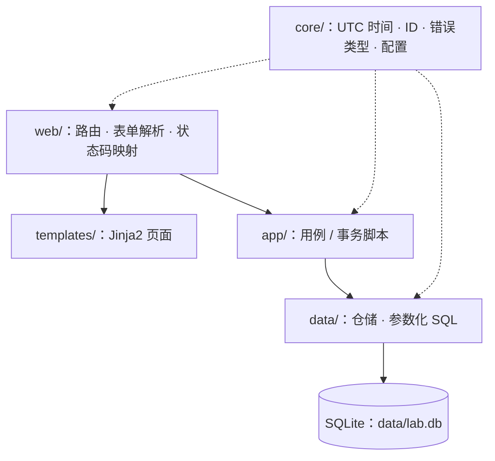
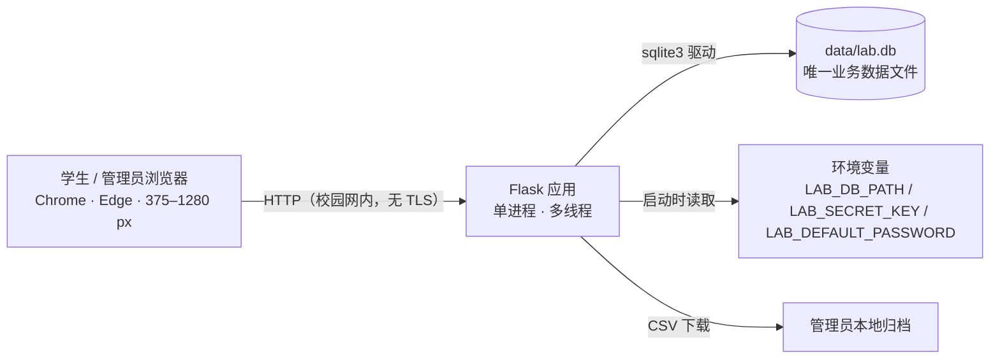
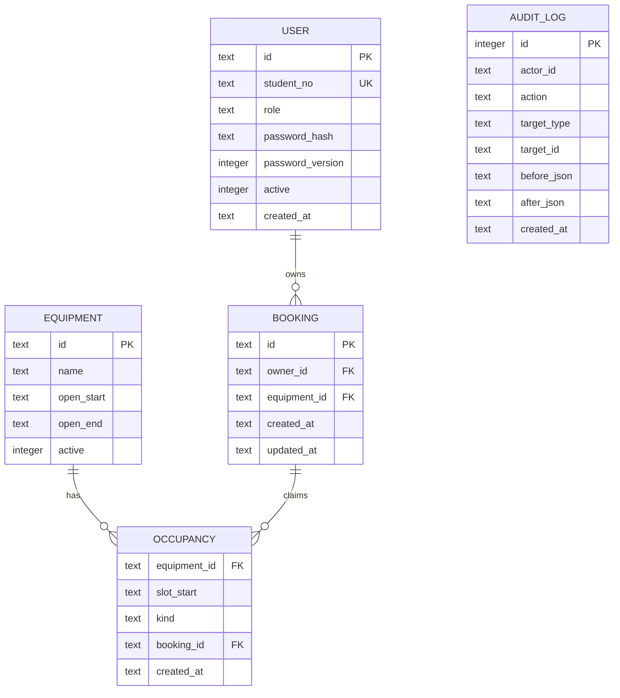
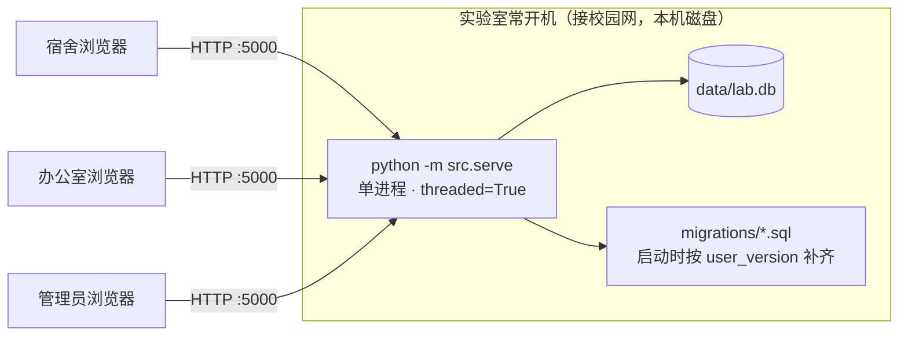

# 架构：实验室设备预约系统

## 0. 一页速览

| ADR | 决定 | 用一句话挡住的分叉 | 主要依据 |
| --- | --- | --- | --- |
| ADR-001 | `(equipment_id, slot_start)` 由数据库唯一约束裁决，五条写路径共用 | 两个开发者各自写一套"先查后写"，并发下双双成功 | FR-4、FR-5、FR-6、FR-7、NFR-1 |
| ADR-002 | 全部业务数据落在单个 `data/lab.db`，stdlib `sqlite3`，无 ORM | 有人为了"方便"引入外部数据库或缓存，部署从一条命令变成一套运维 | FR-2、FR-3、FR-7、FR-8、NFR-2 |
| ADR-003 | 服务端渲染，表单 POST + 303，slot 用复选框多值提交 | 有人加一个前端框架和 JSON 接口，校验逻辑在两端各写一遍 | FR-2、FR-3、FR-7、NFR-2、NFR-3 |
| ADR-004 | 签名 Cookie 会话 + 密码版本号失效 | 有人加 session 表或 JWT，重置密码后旧会话仍然有效 | FR-1、NFR-2、NFR-4 |
| ADR-005 | 所有时刻以定长 UTC 文本存储，转换只在一个模块发生 | 有人存本地时间或带 `+08:00` 的字符串，同一时刻出现两种字符串，唯一键失效 | FR-4、FR-6、FR-8、NFR-1 |

技术栈由用户锁定：**Python 3.12+（实现基线 3.13.9）+ Flask 3 + SQLite + Jinja2 + pytest**。本文不做选型再讨论，只在 ADR 的"被否决的备选"里记录为什么别的路不走。

## 1. 本文档管什么

这是构建契约，不是设计说明。它只固定"两个单元分别实现、会互相不兼容"的调用；能由合规代码直接读出来的东西（函数签名、模板变量名、字段全貌）不在这里重复。

判断标准只有一条：**如果两个人分别实现下一层，会不会做出不兼容的选择？** 会，且不显然，且是真实取舍——才写进来。其余进第 17 节 Deferred。

## 2. 范式与依赖方向

**分层单体 + 事务脚本（Layered monolith + Transaction Script）**。没有领域模型层，没有事件总线，没有后台任务。每个用例就是一个函数：开始事务、校验、写、提交、映射错误。



四条依赖规则，违反即视为架构缺陷：

1. 依赖只能向下：`web → app → data → SQLite`。`data` 不得 import `web` 或 `app`，`app` 不得 import `web`。
2. 模板不执行业务：`templates/` 只消费路由传入的只读视图对象，不查库、不算占用状态、不拼 SQL。
3. `data/` 不抛 HTTP 异常：仓储只返回领域对象或抛 `core/errors.py` 里的 `Conflict` / `NotFound` / `Forbidden`；HTTP 状态码只在 `web/` 一处映射。
4. 写 `occupancy` 只有一个入口：`app/booking_service.py` 的四个用例（创建 / 改单 / 锁定 / 取消），统一经 `data/occupancy_repo.py` 的 `insert_occupancy()` 与 `delete_occupancy()`。任何其他模块直接 INSERT/DELETE `occupancy` 都算越界——这是 ADR-001 能被验证的前提。

## 3. 系统边界

一个进程、一个数据库文件、一个浏览器可达的 HTTP 入口。没有第二个服务。



边界外的三件事，明确不连：统一认证（CAS/OAuth）、通知通道（邮件/短信）、任何缓存或消息中间件。

## 4. 核心不变量

除 5 条 ADR 外，还有四条规则同样具有约束力。它们不属于"选型"，但两个开发者独立实现时最容易分叉。

| 不变量 | 规则 | 防止的分叉 |
| --- | --- | --- |
| **slot 是派生量，不是数据** | 不建 `slot` 表。某设备某天的 slot 集合 = 由 `open_start`/`open_end` 按 30 分钟切分得到，边界对齐 `:00`/`:30`。数据库只记录"被占用的 slot"。 | 有人建了 slot 表并与开放时间双写，改开放时间后两者不一致（FR-2） |
| **`occupancy` 是唯一事实源** | `booking` 行不冗余存储 slot 范围；"我的预约"的时间段由 `occupancy` 反查。取消 = 删除 `occupancy` 行。 | 有人给 `booking` 加 `start_slot`/`end_slot`，与占用行对不上（FR-4、FR-6） |
| **审计与变更同事务** | 任何写操作产生的 `audit_log` 条目与该写操作在同一事务提交；不允许"写完再记日志"。 | 有人先提交业务写、异步补日志，进程崩溃后留下无主变更（FR-7、FR-8） |
| **状态码只有一处映射** | `Conflict → 409`、`Unauthorized → 401`、`Forbidden → 403`、`Validation → 400`，映射表写在 `web/errors.py`。 | 有人在新路由里手写 `return "冲突", 400`，同一语义两种状态码（FR-5） |
## 5. ADR-001 — 并发唯一约束：`(equipment_id, slot_start)` 由数据库裁决

**状态**：已采纳（D-001，2026-11-04）
**约束范围（Binds）**：FR-4、FR-5、FR-6、FR-7、NFR-1；`occupancy` 表；预约创建、管理员改单、锁定、解锁、取消五条写路径。

### 5.1 决定

**`(equipment_id, slot_start)` 的唯一性由数据库的命名 UNIQUE 约束保证，不由应用层的"先查后写"保证。** 同一设备同一 30 分钟 slot 在全库最多存在一行占用记录（预约或锁定），第二次写入会在 `INSERT`（`executemany`）语句处**立即**抛出 `IntegrityError`（SQLite 的 UNIQUE 是即时约束，不会延迟到 `COMMIT`；可延迟的只有声明为 `DEFERRABLE` 的外键），由用例捕获后整单回滚并返回 409。

#### D1. 表结构与约束（实现级）

```sql
CREATE TABLE occupancy (
    equipment_id TEXT NOT NULL
        REFERENCES equipment(id) ON DELETE RESTRICT,
    slot_start   TEXT NOT NULL
        CHECK (length(slot_start) = 20
               AND slot_start GLOB
                   '[0-9][0-9][0-9][0-9]-[0-9][0-9]-[0-9][0-9]T[0-9][0-9]:[0-9][0-9]:00Z'),
    kind         TEXT NOT NULL CHECK (kind IN ('booking', 'lock')),
    booking_id   TEXT REFERENCES booking(id) ON DELETE CASCADE,
    created_at   TEXT NOT NULL,
    CONSTRAINT uq_occupancy_slot UNIQUE (equipment_id, slot_start),
    CHECK ((kind = 'booking' AND booking_id IS NOT NULL)
        OR (kind = 'lock'    AND booking_id IS NULL))
);

CREATE INDEX idx_occupancy_booking ON occupancy(booking_id);
```

约束的五个硬性要求，缺一不可：

1. **命名 UNIQUE 约束，不是查询里的 `GROUP BY` 判断**。`uq_occupancy_slot` 会在 SQLite 中生成一个真实索引，`PRAGMA index_list('occupancy')` 可见 `unique=1`、`origin='u'`。
2. **两列顺序固定为 `(equipment_id, slot_start)`**，不可调换。SQLite 的自动索引列序必须与之一致，测试按 `PRAGMA index_info` 逐列比对。
3. **普通唯一索引，不是部分索引**。取消即删除行（PRD §9 第 3 条、addendum A.2），因此不存在"已取消但仍占着 key"的行，也就不需要 `WHERE status = 'active'`。
4. **锁定与学生预约共用同一键空间**。`kind='lock'` 的行同样占用该 key，所以"锁定后学生能预约"在数据库层就不成立（FR-7）。
5. **`slot_start` 是定长 UTC 文本**（ADR-005）。唯一性是文本相等，格式必须唯一，否则同一时刻的两种写法不会冲突。

#### D2. 写入协议：事务归用例，约束归数据库

事务由用例层开启，仓储函数**不 BEGIN、不 COMMIT、不 ROLLBACK**。这条分工是硬性的：否则"改单"要在同一个事务里删旧行、插新行、更新 booking、写审计，就会撞上嵌套事务。

```python
# data/tx.py —— 全局唯一的事务入口
@contextmanager
def write_tx(conn):
    conn.execute("BEGIN IMMEDIATE")
    try:
        yield conn
        conn.execute("COMMIT")
    except BaseException:
        conn.execute("ROLLBACK")
        raise

# app/booking_service.py —— 用例拥有事务
def create_booking(conn, user_id, equipment_id, slots):
    booking_id = new_id()
    with write_tx(conn):
        conflicts = select_taken(conn, equipment_id, slots)   # 仅影响 409 文案
        if conflicts:
            raise Conflict(conflicts)
        conn.execute(
            "INSERT INTO booking(id, owner_id, equipment_id, created_at, updated_at) "
            "VALUES (?, ?, ?, ?, ?)",
            (booking_id, user_id, equipment_id, now_utc(), now_utc()))
        insert_occupancy(conn, equipment_id, slots, booking_id, "booking")
    return booking_id

# data/occupancy_repo.py —— 无事务控制，可被任何用例复用
def insert_occupancy(conn, equipment_id, slots, booking_id, kind):
    conn.executemany(
        "INSERT INTO occupancy(equipment_id, slot_start, kind, booking_id, created_at) "
        "VALUES (?, ?, ?, ?, ?)",
        [(equipment_id, s, kind, booking_id, now_utc()) for s in slots],
    )
```

四条不可替换的细节：

- **`BEGIN IMMEDIATE`，不用延迟事务**。WAL 下延迟事务先读后写会在升级写锁时返回 `SQLITE_BUSY`（`SQLITE_BUSY_SNAPSHOT`），且事务中途不可安全重试；`IMMEDIATE` 在进入时就拿写锁。写锁到手后事务内不再有其他写者，预检因此是准确的——但**它仍不是裁决者**：下一版可能换连接池、换存储，或有人把预检挪到事务外。唯一约束必须在任何情况下独立成立（§5.4 L4 对照 C 验证）。
- **裸 `INSERT`，绝不 `INSERT OR IGNORE` / `OR REPLACE` / `ON CONFLICT DO NOTHING`**。冲突必须以异常形式到达上层并变成 409（FR-5、SM-5"无静默覆盖"）。
- **冲突在语句处立即抛出，不会等到 `COMMIT`**。SQLite 的 UNIQUE 是即时约束，只有声明为 `DEFERRABLE` 的外键才能延迟到提交。因此 `except` 必须包住 `executemany`，而不是只包住 `COMMIT`。
- **409 的冲突列表在 `ROLLBACK` 之后重新查询**。回滚后重查才只反映对手真实提交的行，不会把本次事务自己的脏写算进去。

#### D3. 连接与 PRAGMA

每个请求从 `flask.g` 取独立连接，请求结束关闭；模块级复用连接一律禁止。

```python
conn = sqlite3.connect(db_path, isolation_level=None)
conn.execute("PRAGMA foreign_keys = ON")
conn.execute("PRAGMA journal_mode = WAL")
conn.execute("PRAGMA busy_timeout = 1000")
conn.execute("PRAGMA synchronous = NORMAL")
```

`busy_timeout` 的数字由预算推导，不是拍脑袋：单个写事务上限 20 ms（`tests/test_booking_latency.py` 用 p99 守住），10 并发最坏排队约 200 ms，1 000 ms 已有 5 倍余量。超过 1 s 说明出现了慢事务或外部锁，此时快速失败比无限等待更诚实。

#### D4. 错误映射（唯一映射点）

按 `sqlite3.Error` 的 `sqlite_errorname` 分类，不匹配异常消息文本——文案会随版本变，加一列就失效。

| `sqlite_errorname` | 附加条件 | 映射 | 说明 |
| --- | --- | --- | --- |
| `SQLITE_CONSTRAINT_UNIQUE` | 冲突列含 `occupancy.equipment_id` 与 `occupancy.slot_start` | **409** | 预约/锁定/改单冲突，返回冲突 key 列表（FR-5） |
| `SQLITE_CONSTRAINT_UNIQUE` | 冲突列含 `user.student_no` | **409** | 学号重复注册（FR-1） |
| 其他 `SQLITE_CONSTRAINT_*` | — | **400** | 外键、CHECK、NOT NULL：输入非法或编程错误，不得吞成 409 |
| `SQLITE_BUSY` / `SQLITE_BUSY_SNAPSHOT` | 发生在 `BEGIN IMMEDIATE` 阶段，且未产生任何写入 | 重试，最多 2 次（退避 20 ms、50 ms） | 重试只对"拿锁失败"有意义 |
| `SQLITE_BUSY` | 事务内已有写入，或重试耗尽 | **503** | 总等待预算 ≤ 1.2 s；NFR-1 判该轮失败，不得计为通过 |

**唯一冲突不做盲目重试。** 重试只对"锁忙"有意义；对唯一冲突重试只会把 409 变成延迟后的 409，掩盖真实争用。**禁止** `except IntegrityError: return 409` 这种整类吞并——它会把外键错误伪装成业务冲突。

#### D5. 五条写路径共用同一约束

| 路径 | 事务内动作 | 失败语义 |
| --- | --- | --- |
| 学生创建预约（FR-4） | `INSERT booking` → N 条 `INSERT occupancy` | 整单回滚，0 行写入；冲突 409 |
| 管理员改单（FR-7） | `SELECT booking WHERE id=?`（不存在 → 404）→ `DELETE` 旧 occupancy → `INSERT` 新 occupancy → `UPDATE booking`（**不改 id**）→ 审计 | 原占用行逐行不变，`booking_id` 保留；冲突 409 |
| 锁定（FR-7） | `INSERT occupancy(kind='lock')` + 审计 | 已占用 → 409 |
| 解锁（FR-7） | `DELETE ... WHERE kind='lock'`，rowcount=0 → 404 + 审计 | 无锁可解 404，不静默成功 |
| 取消（FR-6） | `DELETE FROM booking WHERE id=?`（`ON DELETE CASCADE` 带走 occupancy）+ 审计（`before_json` 存整张快照） | 无此行 → 404；重复取消即 404，不会产生第二份日志 |

**取消删的是 `booking` 行，不只是 occupancy 行。** PRD §3 术语表写明"已取消预约只保留在操作日志中"，因此取消后该 `booking_id` 在库里不存在。这顺带堵住一个漏洞：若把 `booking` 留在库里而只删 occupancy，"先取消、再改单"就会把已取消的预约重新写回占用行，且两条请求都返回成功、都写审计。任何按 `booking_id` 写 occupancy 的路径，都必须在同一事务内先确认 `booking` 行存在。

不存在"管理员强制覆盖"分支。FR-7 要求改单与学生预约共用同一约束，因此这五条路径必须共用 `insert_occupancy()` 与同一个事务入口，而不是各写一段 SQL。

### 5.2 被否决的备选

| # | 备选 | 具体形态 |
| --- | --- | --- |
| A | 应用层先查后写 | `SELECT count(*) WHERE key=?` 为 0 则 INSERT，不加数据库约束 |
| B | 任意区间预约 + 重叠判定 | 存 `start_at`/`end_at`，冲突按 `[start, end)` 重叠查询，事务串行化 |
| C | `INSERT OR IGNORE` 静默跳过 | 冲突行不插入，接口仍返回成功 |
| D | 应用内互斥锁 | `threading.Lock` 或进程内文件锁包住"查—写" |
| E | 外部分布式锁 | Redis / 数据库外的锁服务 |
| F | 软删除 + 部分唯一索引 | 取消时置 `status='cancelled'`，唯一索引加 `WHERE status='active'` |

### 5.3 否决理由（回指 FR/NFR）

- **A 否决：存在 TOCTOU 窗口。** 两个请求可以同时读到"空闲"，随后双双插入。这正是 D-001 要消灭的双预约，直接违反 **FR-5**（冲突必须整单 409）与 **NFR-1**（并发下该 key 最多 1 行）。且该方案在单线程手工测试中永远通过，缺陷只在并发暴露——评审无法从代码看出对错。
- **B 否决：SQLite 没有 exclusion constraint，只能靠事务串行化 + 重叠查询兜底。** 依据 addendum A.1 与 D-001：测试矩阵要覆盖相接、包含、部分重叠、零长度等情形，对 2 人 2 周的成本过高；而固定 30 分钟 slot 用一个唯一索引即可裁决。此外区间方案无法满足 **FR-4** 的"1–8 个连续 slot"计数语义，也削弱 **NFR-1** 的可断言性（"该 key 恰有 1 行"变成"重叠集合为空"）。
- **C 否决：把冲突伪装成成功。** `OR IGNORE` 会让第二次提交返回 2xx 但只写入部分 slot，学生以为占住了实际没有；违反 **FR-5** 的 409 契约与 **SM-5**"无静默覆盖"，并使 **FR-6** 的取消无法确定该删哪些行。
- **D 否决：锁的作用域小于正确性要求。** `threading.Lock` 只在单进程内有效，而 **NFR-1** 明确要求"两个独立进程或两个独立数据库连接"；该方案能通过 demo 却过不了自己写的验收测试。多 worker 部署时锁直接失效。正确性必须落在数据文件上，而不是进程内存里。
- **E 否决：违反 NFR-2 的"无外部服务"。** Redis 或任何锁服务都是第二个运行时依赖，破坏单文件、一条命令启动（**NFR-2**、**SM-4**）；且锁只保护"走锁的代码路径"，`seed` 导入或管理员脚本仍可绕过，保护不完整。
- **F 否决：状态机复杂度换不来收益。** 保留已取消行意味着同一 key 同时存在有效行与历史行，唯一索引必须改成部分索引，所有查询都要带 `status` 过滤；**FR-6** 的"取消后立即可预约"与 **FR-8** 的"仅导出有效预约"都要额外判断。addendum A.2 已判定：取消即删行 + 操作日志，唯一约束保持普通索引。

### 5.4 并发测试如何证明

测试文件 `tests/test_booking_concurrency.py`；现场脚本 `python -m tests.concurrency_demo`（不依赖 pytest）。

**证明分五层。** 顺序不能换：先证明约束存在，再证明它在确定性交错下生效，最后才谈并发。

#### L1. 结构断言——约束真的存在

```python
rows = conn.execute("PRAGMA index_list('occupancy')").fetchall()
# 期望恰有一行：seq=0, name='sqlite_autoindex_occupancy_1', unique=1, origin='u', partial=0
cols = [r[2] for r in conn.execute("PRAGMA index_info('sqlite_autoindex_occupancy_1')")]
assert cols == ["equipment_id", "slot_start"]
```

命名 UNIQUE 约束在 SQLite 中生成 `sqlite_autoindex_occupancy_1`。若约束被删、被改成普通索引、或列序颠倒，这一层立即失败。

#### L2. 确定性交错——主证据，不依赖调度

两个连接、手工排序、每次都能复现：

| 步 | 连接 A | 连接 B | 断言 |
| --- | --- | --- | --- |
| 1 | `BEGIN IMMEDIATE`；`INSERT` key K（不提交） | — | A 成功 |
| 2 | — | `BEGIN IMMEDIATE` | 抛 `SQLITE_BUSY`（写锁被 A 持有） |
| 3 | `COMMIT` | — | A 提交成功 |
| 4 | — | 重试 `BEGIN IMMEDIATE`；`INSERT` 同一 K | 抛 `SQLITE_CONSTRAINT_UNIQUE` |
| 5 | — | `ROLLBACK` | — |
| 6 | 新连接查询 K | — | `COUNT(*) == 1` |

这一层证明的是"约束本身能挡住重复写入"，与被测调度无关。它同时固化 D3 的预算：第 2 步必须在 1 s 内失败，不能挂死。

#### L3. 端到端并发——证明 409 映射存在

- 两个客户端进程（`multiprocessing` 的 `spawn`，Windows 下必须显式指定，入口要有 `if __name__ == "__main__"`），`Barrier(2)` 后同时 POST 同一 key 到**两个独立的服务进程**（不同 `LAB_PORT`、指向同一个库文件），并断言 trace 恰好来自 2 个不同 pid——单进程内两线程能蒙混全绿，证明不了跨进程裁决。
- **成功码按 ADR-003 是 303，不是 2xx。** 客户端 `allow_redirects=False`，断言集合为 `{303: 1, 409: 1, 5xx: 0}`；再单独 GET 一次 `Location`，断言 200。
- 每轮断言：`303 == 1`、`409 == 1`、`5xx == 0`、`SQLITE_BUSY` 计数 == 0；两端都返回后用**第三条新连接**数该 key，`COUNT == 1`；全库 `GROUP BY equipment_id, slot_start HAVING COUNT(*) > 1` 为空。
- 规模：100 轮 × 2 并发；追加 20 轮 × 10 并发（断言 1×303、9×409、0×5xx）。
- 每轮全新 key：预置一台开放时间 `00:00–23:30` 的专用测试设备，`slot_start` 按轮次以 30 分钟递增（100 轮跨约 2 天，仍在 7 天窗口内）。不要按"每天一个 slot"递增，否则第 8 轮就撞上 7 天窗口返回 400，测的就不再是并发。

**重叠必须被证明，否则这一层证明不了"并发"。** 栅栏只保证同时开始发请求，完全串行的两次请求同样会得到"1 成功 + 1 冲突"。因此在写事务入口（`write_tx`）加一个仅在测试配置下生效的 `TEST_CLAIM_HOLD_MS`（默认 0，生产恒为 0），让两侧持锁区间可观测；测试分别记录输家的等锁区间（`lock_request` → `lock_acquired`）与赢家的持锁区间（`lock_acquired` → `lock_released`），**断言二者相交**；用 `write_tx` 的整体进出区间是不行的，那段含等锁时间，加一把进程内互斥锁它照样相交。该断言必须做变异自检：在 `write_tx` 内插入进程级互斥锁时，相交轮次必须掉到 0，否则断言恒真、测试不算数。不相交的轮次记为"未验证并发"并判失败，不得计入通过数。

#### L4. 负向对照——证明测试会失败

一个换个错误实现也能通过的测试，不构成证据。三组对照构成真值表：

| 编号 | 约束 | 预检 | 期望结果 | 证明什么 |
| --- | --- | --- | --- | --- |
| C1 | 有 | 有 | 全绿 | 正常路径 |
| C2 | 有 | 短路（恒返回空） | **仍全绿** | 真正裁决的是数据库约束，不是预检 |
| C3 | 删掉 | 短路 | **必须出现 2 次成功** | 约束才是这次通过的原因 |

C3 必须同时删约束**和**短路预检。只删约束时预检仍会返回 409，脚本永远看不到 2 次成功——那个对照会"失败"，但它证明的是自己不可能成功，属于假阴性。C2 与 C3 合起来才构成完整的变异证明。

#### L5. 原子性——整单拒绝而不是部分写入

- 预占 4 连 slot 中的第 3 个，提交整组：断言 409、响应含该 `slot_start` 与 `equipment_id`、`booking` 行数不变、该 booking 的 occupancy 新增 0 行。
- 改单失败同理：把预约改到已占用 slot，409 后原预约的 occupancy 集合逐行比对不变（FR-7）。

#### 证据留存

pytest 输出与 `concurrency_demo` 的 stdout 归档到 `evidence/`，与 `D-001_2026-11-04_brief-slot-decision.png` 并列，满足 SM-1 / SM-5 的"Demo 现场可复现"。

### 5.5 不在 `occupancy` 上、但同样必须有事务边界的写路径

唯一约束只解决"slot 归谁"。以下写路径不写 `occupancy`，却同样会出现"改了一半"的缺陷：

| 写路径 | 归属 | 事务内必须完成 | 失败语义 |
| --- | --- | --- | --- |
| 修改设备开放时间（FR-2、PRD §9.8） | `app/equipment_service.update_window()` | 校验新窗口（`HH:MM`、`:00/:30` 对齐、`open_start < open_end`）→ 查出该设备已有 occupancy 中落在新窗口之外的本地时刻 → 有则拒绝 → `UPDATE equipment` → 审计 | 409，原配置不变；**不自动迁移、不自动取消**任何预约 |
| 学号注册（FR-1） | `app/auth_service.register()` | `INSERT user`，依赖 `student_no` 唯一约束 | 409，账号总数不变 |
| 重置密码（FR-1、FR-8） | `app/auth_service.reset_password()` | `UPDATE user SET password_hash=?, password_version=password_version+1` + 审计（`before_json` 只记版本号，**不记任何密码值**） | 同事务；任一失败则密码与版本号都不变 |
| 停用误注册账号（PRD §7.3） | `app/admin_service.deactivate_user()` | `UPDATE user SET active=0` + 审计；不得停用最后一个管理员 | 404（无此人）；自停用 403 |
| 设备清单导入（PRD §9.4） | `python -m src.seed` | 按 `equipment_id` upsert，列名固定 `equipment_id,name,open_start,open_end`；整文件一个事务 | 任一列缺失或格式错误 → 整体回滚并打印行号，不留半套数据 |

`EQUIPMENT.open_start` / `open_end` 是**本地墙钟规则**（`HH:MM`），不按 ADR-005 转 UTC——它们描述"每天几点开门"，不是某个瞬间。`slot_start` 才是瞬间。

这五条遵循同一模式：先让数据库判定，或在同一事务内复核，再由 `web/` 把领域异常翻成状态码。不要为它们各写一套"先查一下"。

### 5.6 防止的分叉（Prevents）

- 学生预约与管理员改单各写一套冲突判断，改单绕过约束（FR-7）。
- 有人"优化"成 `INSERT OR IGNORE`，把 409 变成 200（FR-5）。
- 有人用进程内锁让单机 demo 通过，却在双进程验收下双预约（NFR-1）。
- 有人给锁定单独建表，锁定与预约互不感知，锁定 slot 仍可被预约（FR-7）。
- 有人在 `booking` 上冗余存时间段，与 `occupancy` 漂移，取消时删不干净（FR-6）。

## 6. ADR-002 — 单文件 SQLite 承载全部业务数据

**状态**：已采纳
**约束范围（Binds）**：FR-2、FR-3、FR-7、FR-8、NFR-2；数据访问层。

### 6.1 决定

**全部业务数据落在一个 `.db` 文件里，用 Python 标准库 `sqlite3` 直接访问，不引入 ORM、不引入任何外部数据库、缓存或对象存储。**

- **路径**：`data/lab.db`，由环境变量 `LAB_DB_PATH` 覆盖；目录不存在时自动创建；创建失败才报错退出，不静默退到临时目录。
- **表**：`user`、`equipment`、`booking`、`occupancy`、`audit_log`，加上 `PRAGMA user_version` 作为 schema 版本。全部在这一个文件内。
- **访问方式**：`sqlite3` + 参数化 SQL，SQL 只出现在 `data/` 层。不引入 ORM 的理由不是"ORM 不好"，而是本项目要交付的核心证据是具体 DDL、事务边界与约束行为，多一层映射会让评审看不到它。
- **PRAGMA**：`foreign_keys=ON`、`journal_mode=WAL`、`busy_timeout=1000`、`synchronous=NORMAL`。WAL 让"读占用视图"不被"写预约"阻塞，这是 FR-3 刷新即最新与 NFR-1 并发测试同时成立的前提。`synchronous=NORMAL` 是有代价的选择：在 WAL 下它保证库不会损坏，但断电时可能丢失最后几个已提交事务。本机无 UPS、且 PRD §7.3 已接受"无自动备份"，因此接受该风险；若要求"断电不丢事务"，改为 `FULL`，写入延迟上升但数量级仍在毫秒。
- **单文件语义**：业务数据只有一个文件；`-wal` / `-shm` 是运行期临时文件，正常关闭时 checkpoint 后消失，不算第二个数据源（与 PRD NFR-2 的判定一致）。
- **迁移**：`migrations/001_init.sql`、`002_*.sql` 按序号顺序执行，用 `PRAGMA user_version` 记录已应用到第几号；启动时幂等补齐。不引入 Alembic。
- **备份**：停止服务后复制 `.db`，或用 `VACUUM INTO 'backup.db'` 在线快照。**不复制正在使用的 `.db` 而忽略 `-wal`**，否则会丢最近提交。
- **健康检查**：`GET /health` 执行 `SELECT 1` 并返回 200，用于 NFR-2 的启动断言。
- **部署前提**：`data/` 必须在**本机磁盘**。SQLite 的 WAL 依赖共享内存与文件锁，放在 SMB/NFS 网络盘上会损坏或直接不可用。

### 6.2 被否决的备选

| # | 备选 | 具体形态 |
| --- | --- | --- |
| A | MySQL / PostgreSQL | 独立数据库进程，应用通过 TCP 连接 |
| B | 文件即数据库（每次预约一个 JSON） | `data/bookings/<id>.json`，启动时全量加载 |
| C | SQLAlchemy ORM | 声明式模型 + Session 管理事务 |
| D | Redis 做缓存或队列 | 占用视图缓存、异步写 |
| E | 内存库 + 定时落盘 | `:memory:` 运行，定时 dump 到文件 |

### 6.3 否决理由（回指 FR/NFR）

- **A 否决：直接违反 NFR-2 与 SM-4。** NFR-2 要求"运行时不依赖外部数据库、缓存、消息队列、对象存储或云服务，一条命令启动"；MySQL/PostgreSQL 需要安装、建库、配账号、常驻进程，而运维者是"1 名不懂运维的管理员 + 1 名学生技术负责人"（PRD §7.3）。40 名用户、每周数百条写入的负载也用不上它。此外外部数据库会让 **FR-8** 的"周表 CSV 是唯一人工归档手段"失去"复制一个文件即备份"的简单性。
- **B 否决：无法提供 FR-4 / FR-5 要求的多 slot 原子性。** 一次预约要写 1–8 个 slot，文件方案要么把 8 个文件写成一个事务（文件系统没有跨文件事务），要么接受部分写入；**FR-5**"任一 slot 冲突则数据库不新增任何记录"无法满足。并发下两个进程各自写不同文件，也彻底失去 **NFR-1** 的裁决点。
- **C 否决：为一个 5 张表的系统引入不必要的间接层。** ORM 会隐藏本项目最需要被看到的两件事：`uq_occupancy_slot` 的真实索引形状、`BEGIN IMMEDIATE` 的事务边界。而且它带来额外依赖与 Session 生命周期管理，对 2 人 2 周的项目是净负担。若 schema 增长到需要迁移编排，再评估（见 Deferred）。
- **D 否决：NFR-2 明确禁止外部缓存；且没有性能理由。** FR-3 只要求"打开或刷新读取最新状态"，40 人规模下一次 `SELECT` 加索引足够；加缓存反而引入"缓存与库不一致"的新缺陷类别，与"实时占用视图"的承诺冲突。
- **E 否决：破坏持久性。** FR-5 的验收是"数据库最终只有 1 条成功记录"，需要一个已提交、可被第二个进程读到的持久文件；定时落盘会在这个断言上产生不确定窗口，也让 **NFR-2** 的"停止服务后复制 `.db` 数据一致"无法成立。

## 7. ADR-003 — 服务端渲染，表单提交即事务入口

**状态**：已采纳
**约束范围（Binds）**：FR-2、FR-3、FR-7、FR-8、NFR-2、NFR-3；`web/` 与 `templates/`。

### 7.1 决定

**每个页面由 Flask 路由在服务端组装完整 HTML，Jinja2 渲染；所有变更走 HTML 表单 POST，成功后 303 重定向（PRG），失败按语义返回状态码并重渲染同一页面。没有单页应用、没有构建步骤、没有供 UI 使用的 JSON 接口。**

- **slot 选择**：一组 `<input type="checkbox" name="slot" value="2026-11-05T06:00:00Z">`。服务端用 `request.form.getlist("slot")` 取回集合，再校验连续性、数量 1–8、对齐、7 天窗口、开放时间内。**客户端不承担任何正确性判定**，禁用 JS 也能完成 FR-4。表单只提交**一个** `equipment_id`，因此"跨设备”在结构上无法表达；若伪造出不存在的 `equipment_id`、或不属于该设备的 slot，按 400 拒绝。
- **共享渲染单元**：`_slot_grid.html` 同时被学生占用视图（FR-3）与管理员周视图（FR-7）引用。**四态由 `app/slot_service.build_grid()` 唯一计算**，模板只渲染传入的 `cell.state`（`free` / `booked_by_self` / `booked_by_other` / `locked` / `closed_past` / `closed_window`），不做任何时间比较——模板不判状态，只画状态。
- **PRG**：成功一律 `303 See Other` 重定向到结果页，刷新不会重复提交——这是"提交即写"的系统里防止重复预约的第一道人为防线（第二道是 ADR-001 的唯一约束）。
- **409 的重渲染**：返回 409 状态码 + 同一页面，保留用户已选 slot，标出冲突项。不跳转到单独的错误页，避免用户丢失上下文。
- **静态资源**：一个手写 `static/app.css`，不引 CDN、不引 UI 组件库。校园网断外网时页面必须完整可用（NFR-2 的"启动不访问外网"延伸）。
- **转义**：Jinja 自动转义保持开启；设备名等用户输入不得使用 `|safe`。
- **CSRF**：所有 POST 表单带隐藏字段 `csrf_token`。token 的生成、轮换与校验规则归 ADR-004，本节不重复定义。

### 7.2 被否决的备选

| # | 备选 | 具体形态 |
| --- | --- | --- |
| A | React / Vue SPA + JSON API | 前端独立构建，`/api/*` 返回 JSON |
| B | HTMX / Alpine 局部刷新 | 引入运行时脚本库做局部替换 |
| C | 纯静态页 + `fetch` 轮询 | 客户端定时拉取占用状态并重绘 |
| D | 客户端渲染 + 本地状态管理 | 浏览器持有 slot 状态，提交时整包发送 |

### 7.3 否决理由（回指 FR/NFR）

- **A 否决：被本次约束显式禁止，且与 NFR-2 / NFR-3 冲突。** 引入 React 需要 Node 工具链、构建产物、两套依赖树，"一条命令启动"（**NFR-2**、**SM-4**）变成"先 build 再 serve"；而项目一共 8 条 FR、2 名开发者，SPA 带来的收益是零。更实际的是：冲突必须返回 409 并标出具体 slot，服务端渲染天然做到，SPA 还要再造一套错误协议。
- **B 否决：为一个复选框列表引入运行时依赖不值得。** 本项目唯一的交互是"多选连续 slot"，原生复选框 + 表单完全覆盖（**FR-4**）；HTMX/Alpine 只节省几十行模板，却增加了版本、CDN 可用性与调试成本，也违反"无外部资源"的部署前提。
- **C 否决：FR-3 明文排除轮询与推送。** "不依赖任何服务端推送""系统无 WebSocket 或 SSE 连接"是验收项；轮询虽不是 WebSocket，但同样制造持续连接与后台负载，且与"打开或刷新即最新"的模型相悖。真要做实时，也不是首版。
- **D 否决：把校验复制到客户端，必然两端漂移。** 连续性、1–8 个上限、7 天窗口、开放时间边界这些规则若在浏览器里再实现一遍，任何一侧改动都会造成"前端允许、后端 400"或更糟的"前端拦截、后端其实能过"。规则只能有一份，在 `app/` 层（**FR-4**、**FR-7**）。

## 8. ADR-004 — 会话登录：签名 Cookie + 密码版本号

**状态**：已采纳
**约束范围（Binds）**：FR-1、NFR-2、NFR-4；`web/auth.py`、`app/auth_service.py`、`data/user_repo.py`。

### 8.1 决定

**登录态放在 Flask 的签名 Cookie 会话里，服务端不建 session 表；密码用 `werkzeug.security` 加盐哈希；管理员重置密码时递增 `password_version`，使该用户所有既有会话在下一次请求即失效。**

- **会话载荷**：仅 `uid`、`role`、`pv`（密码版本号）；不放姓名、学号等任何身份信息，不放任何可用于提权的字段。Flask 会话 Cookie 只签名、不加密，载荷可被客户端 base64 解码读出，因此上述字段不得当作机密。
- **Cookie**：`HttpOnly=True`、`SameSite=Lax`、`Secure=False`（首版校园网 HTTP，风险见 PRD §7.3 已接受）。登录成功后置 `session.permanent = True`，`PERMANENT_SESSION_LIFETIME=timedelta(hours=12)`，并设 `SESSION_REFRESH_EACH_REQUEST=False`。**三者缺一不可**：少了 `session.permanent` 会退化成浏览器会话 Cookie（关浏览器即失效，12 小时不生效），少了 `SESSION_REFRESH_EACH_REQUEST=False` 会变成每次请求顺延 12 小时的滑动过期（Flask 默认为 `True`）。
- **签名密钥**：`LAB_SECRET_KEY` 必须由环境变量提供，长度不少于 32 字节；缺失或过短时启动失败并给出明确报错。不提供默认值——默认密钥等于没有签名。
- **密码存储**：`generate_password_hash()`（Werkzeug 3 默认 scrypt）+ `check_password_hash()`；`user.password_hash` 是唯一存密码的地方。任何响应、日志、CSV 都不出现明文（NFR-4）。
- **每请求校验**：`@login_required` 从 Cookie 取 `uid`，回库读该用户，比较 `pv == user.password_version` 且 `user.active`。角色以库中值为准，不信任 Cookie 里的 `role`。这样"重置密码"与"停用账号"都不需要额外的会话存储。
- **授权分层**：`@login_required` → 未登录 401；`@admin_required` → 非管理员 403。两者都在路由函数第一行生效，不允许在模板里用 `` 做权限判断。
- **CSRF**：匿名表单用签名 double-submit——GET 下发独立 `csrf` cookie（`HttpOnly`、`SameSite=Lax`、`Secure=False`、12 小时），token 内嵌同一随机串并签名；POST 同时验签与「表单值 == cookie 值」（常量时间比较），缺失或不符返回 400，且校验在业务写入之前。登录成功后轮换 token 并转入会话，登出再轮换。匿名路径不写 session，否则登录失败会带出 session cookie，破坏 FR-1 的「失败不建会话」。**残余风险（已接受）**：HTTP 下若能注入 cookie（中间人）或控制子域，可凑出自洽的 (cookie, token) 组合；首版仅校园网内提供、无子域部署，与 `Secure=False` 一并在 PRD §7.3 接受；改 HTTPS 时同步启用 `Secure=True` 与 `__Host-` 前缀。
- **重置密码是一个原子动作**：`UPDATE user SET password_hash=?, password_version=password_version+1` 与 `INSERT audit_log(action='password_reset')` 在同一事务提交；任一步失败则密码不变、日志也不写（FR-1、FR-8）。

### 8.2 被否决的备选

| # | 备选 | 具体形态 |
| --- | --- | --- |
| A | 服务端 session 表 | `session(id, user_id, expires_at)`，Cookie 只存 session id |
| B | JWT（无状态令牌） | 登录返回签名 JWT，客户端每次携带 |
| C | Flask-Login 扩展 | 用现成扩展管理 `current_user` 与 `login_required` |
| D | 学校统一认证（CAS/OAuth） | 跳转校方登录页换取身份 |
| E | Redis 存会话 | 会话集中存储，多进程共享 |

### 8.3 否决理由（回指 FR/NFR）

- **A 否决：多一张表、多一个清理任务，只为一个本项目不存在的需求。** 服务端 session 表的价值是"集中吊销"，而本项目唯一的吊销场景是管理员重置密码（**FR-1**、UJ-4），`password_version` 一个整数就覆盖了。session 表还会带来过期行清理、并发更新、以及"Cookie 有效但表里没有"的新故障态。
- **B 否决：JWT 无法在过期前吊销，直接违背 FR-1 的重置语义。** 管理员重置密码后，旧 JWT 在有效期内仍然可用，除非再引入黑名单——那就等于把 A 又做了一遍，还多了密钥轮换问题。JWT 的收益是跨服务无状态校验，而本系统只有一个进程（**NFR-2**），收益为零。
- **C 否决：为一个装饰器引入依赖。** 两个角色、约 10 个路由，`@login_required` 与 `@admin_required` 各十来行即可；Flask-Login 的 `UserMixin`、`user_loader`、`remember me` 都超出 **FR-1** 的范围（本项目不做"记住我"、不做密码找回）。少一个依赖就少一处版本与安全公告负担。
- **D 否决：范围外。** FR-1 与 Brief §6 明确"不接学校统一认证"；接入 CAS 需要校方对接、回调地址、证书，与"2 人 2 周、单机部署"直接冲突（**NFR-2**）。
- **E 否决：NFR-2 禁止外部服务。** 与会话存 Redis 同一理由；且单进程部署下没有任何共享需求。

## 9. ADR-005 — 所有时刻以 UTC 存储，本地时区只在边界转换

**状态**：已采纳
**约束范围（Binds）**：FR-4、FR-6、FR-8、NFR-1；全部表的时间列与 `core/timeutil.py`。

### 9.1 决定

**数据库里的每一个时刻都是定长 UTC 文本 `YYYY-MM-DDTHH:MM:SSZ`（20 字符）。Asia/Shanghai 只出现在两个边界：用户输入的解释、页面与 CSV 的展示。转换只能在 `core/timeutil.py` 里发生。**

- **格式固定 20 字符**：`2026-11-05T06:00:00Z`。定长 + 零填充意味着**字典序等于时间序**，`ORDER BY slot_start` 与 `WHERE slot_start >= ?` 都无需函数转换，索引可用。
- **唯一写法**：同一时刻只有一种字符串。这既是 ADR-001 唯一键成立的前提（文本相等即时刻相等），也是排序正确的前提。
- **`slot_start` 的语义**：Asia/Shanghai 本地时间对齐 `:00`/`:30` 的那个瞬间，转成 UTC 后存储。由于该时区常年 +08:00 且无夏令时（PRD §3 假设），UTC 侧也落在 `:00`/`:30`；但代码不得依赖这个巧合，必须经 `zoneinfo` 转换得出。
- **转换函数只有四个**：`now_utc()`、`local_to_utc()`、`utc_to_local()`、`week_bounds_utc()`。业务代码不得直接调用 `datetime.now()`（无 tz）、不得字符串拼接时间。
- **自然周（FR-8）**：在本地时区算出 `[周一 00:00, 下周一 00:00)`，两端各转 UTC，查询用半开区间 `slot_start >= ? AND slot_start < ?`。绝不用 `BETWEEN`——右端闭区间会在周一 00:00 多算一条。
- **时间窗口（FR-4 / FR-6）**：7 天窗口与 2 小时截止都用 UTC 瞬时比较，不比较本地字符串。
- **默认值不由数据库生成**：禁止 `DEFAULT CURRENT_TIMESTAMP`（它产出 `YYYY-MM-DD HH:MM:SS` 的另一种格式，破坏唯一写法与 CHECK 约束）；时间戳一律由应用传入参数。
- **时区数据**：`zoneinfo.ZoneInfo("Asia/Shanghai")`；Windows 上需在依赖中显式加入 `tzdata`，否则运行时会找不到时区。

### 9.2 被否决的备选

| # | 备选 | 具体形态 |
| --- | --- | --- |
| A | 存本地时间（无时区） | `2026-11-05 14:00:00`，默认按服务器本地时区解释 |
| B | 存 epoch 整数 | `slot_start INTEGER`（Unix 秒） |
| C | 存带偏移的 ISO 字符串 | `2026-11-05T14:00:00+08:00` |
| D | 交给数据库生成时间 | `DEFAULT CURRENT_TIMESTAMP` / `datetime('now')` |

### 9.3 否决理由（回指 FR/NFR）

- **A 否决：正确性依赖"机器时区恰好是 Asia/Shanghai"，而这个前提无法被测试保证。** 换一台机器、容器默认 UTC、或学生技术负责人改了系统时区，所有已存数据立刻错 8 小时：**FR-4** 的 7 天窗口会把已开始的 slot 判成可约，**FR-6** 的 2 小时截止会提前或延后，**FR-8** 的自然周边界整体偏移。更隐蔽的是 **NFR-1**：同一个 slot 在不同时区的进程里算出不同字符串，唯一约束不再拦截同一物理时段。
- **B 否决：正确但不可读，代价落在本项目最需要人工核对的地方。** epoch 整数在 `sqlite3` 命令行、CSV、种子文件、并发测试输出里都无法直接辨认，而 PRD §7.3 明确"周表 CSV 是唯一的人工归档手段"。为了让 CSV 可读又得再加一层格式化，等于用两个表示换一个定长字符串。
- **C 否决：直接摧毁 NFR-1 的唯一键。** `2026-11-05T14:00:00+08:00` 与 `2026-11-05T06:00:00Z` 是同一时刻的两个字符串，在文本唯一索引下**不相等**。只要有一条写入路径用了另一种写法（例如某次由前端直接回传），同一物理 slot 就能被预约两次——这是最危险的一种"看起来有约束"。**FR-5** 与 **NFR-1** 同时失效。
- **D 否决：格式不受控。** SQLite 的 `CURRENT_TIMESTAMP` 产出 `YYYY-MM-DD HH:MM:SS`（空格分隔、无 `T`、无 `Z`），与本文约定的 20 字符格式不同，会同时违反 `CHECK` 约束与字典序假设；`datetime('now')` 虽返回 UTC，但语义埋在 SQL 里，无法在应用层统一测试。统一由 `core/timeutil.py` 注入，才有一处可测。

### 9.4 防回归

`tests/test_time_format.py` 两条断言：所有时间列的取值匹配 `^\d{4}-\d{2}-\d{2}T\d{2}:\d{2}:00Z$`；全仓库源码中除 `core/timeutil.py` 外不出现 `datetime.now(`（用 `grep` 式静态检查实现）。这条测试很便宜，但能挡住绝大部分时区回退。

## 10. 数据模型

只画名字与关系；字段细节归 `migrations/001_init.sql`。凡是本身构成不变量的字段，已在 ADR 里约束。



四点必须说清楚：

- **`BOOKING` 不存时间段，也不存"已取消"状态。** 一次预约包含哪些 slot，唯一来源是 `OCCUPANCY` 中 `booking_id` 相同的行；取消即删除该 `booking` 行（`ON DELETE CASCADE` 带走占用行），历史只在 `AUDIT_LOG`（PRD §3）。因此"已取消但还活着"的行不存在，"取消后改单复活"也不可能发生。
- **`OCCUPANCY` 没有 `id` 主键**，`(equipment_id, slot_start)` 就是业务主键。锁定行 `booking_id IS NULL`，预约行 `booking_id NOT NULL`。
- **`USER.active`** 是 PRD §7.3"管理员注销误注册账号"的落点；ADR-004 的每请求校验读它。
- **`AUDIT_LOG` 只追加**：没有 UPDATE/DELETE 语句，没有对应路由（FR-8）。

### 10.1 CSV 导出契约（FR-8）

| 项 | 固定值 |
| --- | --- |
| 编码 | UTF-8 with BOM（Python `encoding="utf-8-sig"`） |
| 表头 | `设备,slot 开始,slot 结束,学号,booking_id,状态` 六列，顺序固定 |
| 行 | 一行一个 slot；一条 3-slot 预约导出 3 行，共享同一 `booking_id` |
| slot 结束 | `slot_start + 30 分钟`，由服务端计算，不由客户端传 |
| 时间列 | 转 `Asia/Shanghai` 后 `YYYY-MM-DD HH:MM` |
| 范围 | 自然周 `[周一 00:00, 下周一 00:00)` 本地时间对应的 UTC 半开区间 |
| 过滤 | 只导 `kind='booking'` 且 `booking_id IS NOT NULL`；已取消预约已不在库中，无需额外过滤 |
| 状态 | 固定集合 `有效`（首版只有这一种，保留该列以备后续） |
| 禁止 | 任何密码字段、会话 token、内部自增 id |

### 10.2 审计与脱敏契约（FR-8、NFR-4）

```sql
CREATE TABLE audit_log (
    id          INTEGER PRIMARY KEY,
    actor_id    TEXT NOT NULL,
    action      TEXT NOT NULL CHECK (action IN (
                  'register','login_fail','booking_create','booking_cancel','booking_edit',
                  'lock','unlock','password_reset','user_deactivate','equipment_update')),
    target_type TEXT NOT NULL CHECK (target_type IN ('booking','equipment','user')),
    target_id   TEXT NOT NULL,
    before_json TEXT,
    after_json  TEXT,
    created_at  TEXT NOT NULL,
    CHECK (before_json IS NOT NULL OR after_json IS NOT NULL)
);

CREATE INDEX idx_audit_created ON audit_log(created_at DESC);
CREATE INDEX idx_audit_actor ON audit_log(actor_id, created_at DESC);
```

- `before_json` / `after_json` 只写**领域字段白名单**，由 `core/redact.py` 统一序列化。白名单之外一律不写：`password_hash`、任何明文密码、`LAB_DEFAULT_PASSWORD`、会话 token、`LAB_SECRET_KEY`。
- 锁定/解锁的 `target_type='equipment'`，但 slot 列表必须进 `after_json`（`{"slots": [...]}`），否则 FR-7"每次锁定均写入操作日志"只记了"锁过这台设备"。
- 重置密码的 `before_json` 只记 `{"password_version": n}`，`after_json` 记 `{"password_version": n+1}`——**永不记录密码值**。
- 日志页只读，无编辑/删除路由。

## 11. 一致性约定

| 关注点 | 约定 |
| --- | --- |
| 命名 | 表与列 `snake_case` 单数；Python 模块 `snake_case`；集合资源路由用复数（`/bookings`、`/equipments`、`/users`）；模板 `snake_case.html`，局部模板以 `_` 开头 |
| ID | `booking.id` / `user.id` / `equipment.id` 为 `uuid4().hex`（32 位小写十六进制）；`equipment.id` 允许由 `seed/equipment.csv` 指定可读 slug；`student_no` 是业务标识，不是主键 |
| 时间 | 一切时刻 `YYYY-MM-DDTHH:MM:SSZ`（20 字符）；展示层由 Jinja 过滤器转 `Asia/Shanghai`。`equipment.open_start/open_end` 是例外：本地墙钟 `HH:MM`，不是时刻 |
| 枚举 | slot 状态只有六个值：`free` / `booked_by_self` / `booked_by_other` / `locked` / `closed_past` / `closed_window`；审计 `action` 与 `target_type` 用 CHECK 封闭（§10.2） |
| 校验 | 形状校验（:00/:30 对齐、连续、1–8 个、开放时间内、7 天窗口、2 小时截止）**只在 `app/slot_rules.py` 做一次**，用 `mode=create/edit` 区分场景；管理员不豁免。`web/` 只把表单字符串转成域对象 |
| 错误 | 状态码只在 `web/errors.py` 映射：`Validation→400`、`Unauthorized→401`、`Forbidden→403`、`NotFound→404`、`Conflict→409`、`Unavailable→503`。409 响应体必须列出冲突的 `equipment_id` 与 `slot_start`（FR-5） |
| 归属 | 学生只能取消自己的 `booking`（`owner_id` 不符 → 403），**不能改约**——改期＝取消后重新预约，改单是管理员能力（PRD §6）。管理员走独立 `/admin/*` 路由，不在学生路由里加 if 分支 |
| 模板契约 | 四态由 `app/slot_service.build_grid()` 唯一计算，模板只渲染 `cell.state` 字符串，**不做任何时间比较**；学生日视图与管理员周视图共用 `_slot_grid.html` |
| 事务 | 每个写用例一个 `write_tx()`；仓储函数不 BEGIN/COMMIT；审计写在事务内；跨多 slot 的写要么全成要么全不成（ADR-001） |
| 认证 | 路由第一行加 `@login_required` / `@admin_required`；权限判断不进模板；角色与 `password_version` 每请求回库核对（ADR-004） |
| 导出 | CSV 见 §10.1：`utf-8-sig`、六列固定、一行一个 slot |
| 脱敏 | 日志与导出的序列化只走 `core/redact.py` 的**字段白名单**，不用黑名单过滤 `password`（NFR-4） |
| 配置 | 只从环境变量读；缺 `LAB_SECRET_KEY` / `LAB_DEFAULT_PASSWORD` 时启动失败而非降级 |
| 日志 | 输出到 stdout；记录方法、路径、状态码、用户 id；**不记录表单体、密码、Cookie** |

## 12. 技术栈

实现与测试基线为 Python 3.13.9（作者机器）；3.12 为兼容下限，代码不使用 3.13 独有语法。下表版本在上述环境核对，`requirements.txt` 的下限按 3.12 可取到的最新版标注。较低版本未单独复跑，若评审在 3.12 上运行，以 `python -c "import sqlite3;print(sqlite3.sqlite_version)"` 的输出为准。

| 名称 | 版本 |
| --- | --- |
| Python | 3.13.9（实现与测试基线）；3.12+ 为兼容下限 |
| Flask | 3.1.3 |
| Jinja2 | 3.1.6 |
| Werkzeug | 3.1.3 |
| itsdangerous | 2.2.0 |
| SQLite | ≥ 3.24（命名 UNIQUE 约束 + `GLOB` CHECK）；Windows 版 CPython 自带版本以 `sqlite3.sqlite_version` 实测为准 |
| pytest | 8.4.2 |
| tzdata | ≥ 2024.1（仅 Windows 需要，供 `zoneinfo` 使用） |

运行期依赖只有以上这些。完整清单落在 `requirements.txt`，不引入前端工具链、ORM、缓存客户端、任务队列客户端。

## 13. 目录结构

```text
MyProject2/
  app.py                  # create_app()：注册蓝图、错误映射、请求钩子
  src/
    serve.py              # python -m src.serve 的唯一入口
    web/                  # 路由、表单解析、状态码映射（唯一映射点）
    app/                  # 用例与事务脚本
      booking_service.py  # occupancy 的唯一写入口
      slot_rules.py       # 形状校验的唯一入口（create/edit 两种 mode）
      slot_service.py     # build_grid()：slot 状态的唯一生产者
    data/                 # 仓储与参数化 SQL
      tx.py               # write_tx()：全局唯一的事务入口
    core/                 # timeutil、ids、errors、config、redact
    templates/            # base.html、_slot_grid.html、页面模板
    static/               # app.css
    seed.py               # python -m src.seed 导入设备与管理员
  migrations/             # 001_init.sql ...，由 PRAGMA user_version 驱动
  seed/equipment.csv      # 管理员提供的设备清单
  tests/                  # pytest
  data/lab.db             # 运行时生成，不入版本库
```

## 14. 能力 → 架构映射

| 能力 | 落点 | 受什么约束 |
| --- | --- | --- |
| FR-1 学号密码账号 | `web/auth.py`、`app/auth_service.py`、`data/user_repo.py` | ADR-004；`USER.student_no` 唯一 → 409；§5.5 重置密码事务 |
| FR-2 设备清单与开放时间 | `web/equipment.py`、`app/equipment_service.update_window()` | ADR-002、ADR-003；slot 派生（§4）；§5.5 越界即 409 |
| FR-3 占用状态视图 | `web/slots.py`、`app/slot_service.build_grid()`、`templates/_slot_grid.html` | ADR-003（模板只画不算）；ADR-002（WAL 读不被写阻塞） |
| FR-4 提交连续 slot | `app/booking_service.create_booking()`、`app/slot_rules.py` | ADR-001、ADR-005 |
| FR-5 冲突原子拒绝 | `app/booking_service.py`、`occupancy` DDL、`web/errors.py` | ADR-001（唯一约束是裁决者，§5.4 证明） |
| FR-6 我的预约与取消 | `app/booking_service.cancel_booking()` | ADR-001 D5（删 booking 行）；§11 归属（403） |
| FR-7 周视图 / 检索 / 改单 / 锁定 | `web/admin.py`、`app/admin_service.py` | ADR-001 D5（共用 `insert_occupancy`）；ADR-003 |
| FR-8 导出与操作日志 | `app/export_service.py`、`app/audit.py` | ADR-002、ADR-005；§10.1 CSV 契约、§10.2 审计契约 |
| NFR-1 并发正确性 | `tests/test_booking_concurrency.py` | ADR-001 §5.4（L1–L5） |
| NFR-2 可运维 | `app.py`、`src/serve.py`、`migrations/`、`data/lab.db` | ADR-002 |
| NFR-3 响应式零安装 | `templates/`、`static/app.css` | ADR-003 |
| NFR-4 凭据安全 | `app/auth_service.py`、`app/audit.py`、`app/export_service.py` | ADR-004；`core/redact.py` 字段白名单 |

## 15. 部署与运行

单机、单进程、多线程。**不引入 Docker**：容器运行时本身就是一个需要安装的额外前提，与"运行时已预装、一条命令启动"（NFR-2、SM-4）相悖。



| 环境变量 | 作用 | 缺省行为 |
| --- | --- | --- |
| `LAB_DB_PATH` | 数据库文件路径 | `./data/lab.db` |
| `LAB_SECRET_KEY` | 会话签名密钥，≥ 32 字节 | **启动失败** |
| `LAB_DEFAULT_PASSWORD` | 管理员重置后的默认密码，≥ 8 位 | **启动失败** |
| `LAB_ADMIN_USER` / `LAB_ADMIN_PASSWORD` | `python -m src.seed` 创建管理员 | seed 时必需 |
| `LAB_HOST` / `LAB_PORT` | 监听地址与端口 | `0.0.0.0` / `5000` |

启动顺序固定：读配置 → 打开数据库（PRAGMA）→ 应用迁移（`user_version`）→ 注册蓝图 → 监听。`GET /health` 返回 200 是"服务可用"的唯一判据（NFR-2）。

### 15.1 路由表

| 方法 | 路径 | 鉴权 | 写哪张表 |
| --- | --- | --- | --- |
| GET | `/health` | 无 | 读（`SELECT 1`） |
| GET/POST | `/register` | 无 | `user` |
| GET/POST | `/login` | 无 | 无（只写会话） |
| POST | `/logout` | 登录 | 无 |
| GET | `/equipments` | 登录 | 读 |
| GET | `/slots?equipment_id=&date=` | 登录 | 读 |
| POST | `/bookings` | 登录 | `booking`、`occupancy`、`audit_log` |
| GET | `/bookings/mine` | 登录 | 读 |
| POST | `/bookings/<id>/cancel` | 登录 + 归属 | `booking`、`occupancy`、`audit_log` |
| GET | `/admin/week` | 管理员 | 读 |
| POST | `/admin/bookings/<id>/edit` | 管理员 | `booking`、`occupancy`、`audit_log` |
| POST | `/admin/equipments/<id>/lock` | 管理员 | `occupancy`、`audit_log` |
| POST | `/admin/equipments/<id>/unlock` | 管理员 | `occupancy`、`audit_log` |
| POST | `/admin/equipments/<id>/window` | 管理员 | `equipment`、`audit_log` |
| POST | `/admin/users/<id>/reset-password` | 管理员 | `user`、`audit_log` |
| POST | `/admin/users/<id>/deactivate` | 管理员 | `user`、`audit_log` |
| GET | `/admin/export?week=` | 管理员 | 读 |
| GET | `/admin/audit` | 管理员 | 读 |

免鉴权清单只有三项：`/health`、`/register`、`/login`。其余一律 `@login_required`，`/admin/*` 一律 `@admin_required` 叠加。

**运维边界**：不做进程守护、不做日志轮转、不做自动备份。断电后库不损坏，可恢复到最后一次成功的 checkpoint；`synchronous=NORMAL` 下最后若干已提交事务可能丢失（ADR-002 已接受）。数据丢失的兜底是管理员每周导出的 CSV（PRD §7.3 已接受）。

## 16. 明确不引入

以下被本次约束禁止，任何后续设计不得以此为前提；出现即视为范围蔓延，需要先改约束而不是先写代码。

| 技术 | 若不引入会失去什么 | 为什么仍然不引入 |
| --- | --- | --- |
| React（或任何 SPA 框架） | 局部刷新体验 | 8 条 FR、零安装、一条命令启动；服务端渲染已满足 FR-3 与 NFR-3 |
| MySQL / PostgreSQL | 更强并发与运维工具 | 违反 NFR-2 单文件；40 人规模无收益（ADR-002） |
| Redis | 缓存、分布式锁、会话共享 | 违反 NFR-2；无对应性能或一致性需求（ADR-002、ADR-004） |
| 消息队列 | 异步通知、削峰 | 首版不做通知；同步写耗时在毫秒级（ADR-002） |
| WebSocket / SSE | 实时推送 | FR-3 明确"打开或刷新即最新"，且显式声明无推送连接（ADR-003） |

## 17. Deferred

以下决定故意留到下一层或下一版，每条都写明为什么可以等。

| 事项 | 为什么可以等 | 触发条件 |
| --- | --- | --- |
| HTTPS、校内域名、证书续期 | 首版仅校园网内使用，风险已在 PRD §7.3 接受；不影响任何数据不变量 | 需要校外访问或接入学校门户时 |
| 自动备份与恢复演练 | 单文件可手工复制，周表 CSV 是现行归档手段 | 出现真实数据丢失事故，或用户数超过 40 |
| 迁移编排工具（Alembic） | 5 张表、编号 SQL 足够；引入 ORM 迁移会牵出 ORM | schema 变更频率超过每月一次 |
| 区间预约（非 30 分钟对齐） | 现有 `occupancy` 已是 slot 级事实，未来可在其上叠加区间视图 | 出现真实的 15 分钟级需求 |
| 审计日志保留期与不可篡改 | PRD §6 明确"不是合规审计系统" | 有外部审计要求时 |
| 分页、全文检索 | 40 人、每周数百条，全表扫描可接受；审计表已建 `idx_audit_created` | 单周记录超过 5000 行，或审计表超过 20000 行 |
| 登录失败限流、锁定 | 校园网内、40 人、管理员可当面处理 | 对公网开放时 |
| 多管理员与权限分级 | Brief 明确 1 名管理员 | 出现第二名管理员 |
| 学生自助改约 | 首版只允许取消后重约（PRD §6） | 取消率明显偏高时 |
| 结构化日志与指标 | 单机、单进程，stdout 加 `/health` 足够 | 出现难以复现的线上问题时 |
| 容器化与进程守护 | 见 §15 的理由；与"一条命令"冲突 | 迁移到多机部署时 |

## 18. 待确认

不阻塞开工，但需要在对应 Story 开始前给答案。

1. **会话有效期 12 小时**是否为合适值（学生可能晚上预约、次日到场）。改这一项需同时调 `PERMANENT_SESSION_LIFETIME` 与登录前端的提示文案，不影响其他 ADR。
2. **审计日志保留多久**。当前不清理；若一年后行数影响查询，再加归档策略。
3. ~~PRD §11 溯源表需要补一行 ADR-005~~——已于 2026-11-05 回写，FR-3/4/6/7/8 的 ADR 列均含 ADR-005；此条保留作已关闭记录。
